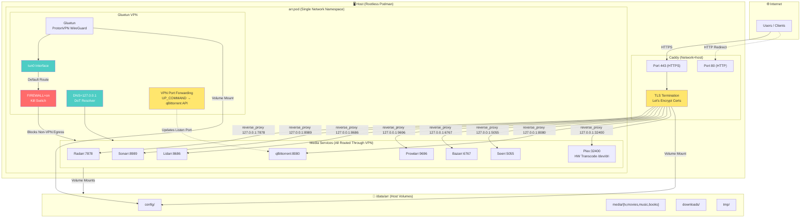

# ARR‑Stack using Podman Quadlets (Rootless, VPN Kill Switch)

## Overview

This repository provides a **rootless Podman quadlet** deployment for the ARR media suite (Radarr, Sonarr, Lidarr, Prowlarr, Bazarr, Seerr), qBittorrent, and Plex — all routed through a **Gluetun ProtonVPN WireGuard tunnel with a true kill switch** — behind a Caddy reverse proxy.

**Key features:**
- Single pod (`arr`) = single network namespace = **no DNS leaks, no bypass**
- Gluetun's `FIREWALL=on` blocks **all** non-VPN egress from every container
- Caddy on host network terminates TLS, proxies to `127.0.0.1:<port>`
- qBittorrent port forwarding automated via gluetun → qBittorrent API
- All data under `/data/arr` for simple backups/migrations

## Architecture



## Folder structure

```
/data/arr
├── config        # Configuration files for each service
│   ├── radarr
│   ├── sonarr
│   ├── lidarr
│   ├── prowlarr
│   ├── bazarr
│   ├── seerr
│   ├── plex
│   ├── qbittorrent
│   ├── gluetun
│   └── caddy
├── media         # Media libraries
│   ├── tv
│   ├── movies
│   ├── kidsmovies
│   ├── kidstv
│   ├── music
│   └── books
├── downloads     # Download directories
│   ├── radarr
│   ├── sonarr
│   ├── lidarr
│   └── prowlarr
└── tmp           # Temporary folders
    ├── radarr
    ├── sonarr
    ├── lidarr
    ├── prowlarr
    └── plex-transcode
```

## Quick start guide

### 1. Prepare host

```bash
# Create directories
sudo mkdir -p /data/arr/config/{radarr,sonarr,lidarr,prowlarr,bazarr,seerr,plex,caddy,qbittorrent,gluetun}
sudo mkdir -p /data/arr/media/{tv,movies,kidsmovies,kidstv,music,books}
sudo mkdir -p /data/arr/downloads/{radarr,sonarr,lidarr,prowlarr}
sudo mkdir -p /data/arr/tmp/{radarr,sonarr,lidarr,prowlarr,plex-transcode}
sudo chown -R $(id -u):$(id -g) /data/arr

# Allow rootless Caddy to bind ports 80/443
sudo sysctl -w net.ipv4.ip_unprivileged_port_start=0
echo 'net.ipv4.ip_unprivileged_port_start=0' | sudo tee /etc/sysctl.d/99-unprivileged-ports.conf

# Plex hardware transcoding access
sudo usermod -aG video $USER
# Re-login after this command
```

### 2. Configure Gluetun (ProtonVPN credentials)

The playbook creates `/data/arr/config/gluetun/gluetun.env` from `config/gluetun.env` with all settings. You only need to add your WireGuard private key:

```bash
vim /data/arr/config/gluetun/gluetun.env
# Uncomment and set your WireGuard private key from ProtonVPN dashboard:
# WIREGUARD_PRIVATE_KEY=your_private_key_here
# Optional: specific server/country
# SERVER_COUNTRIES=Switzerland
# WIREGUARD_ADDRESSES=10.x.x.x/32
```

All other settings (VPN provider, port forwarding, firewall, kill switch) are pre-configured in the file.

### 3. Install quadlets

```bash
mkdir -p ~/.config/containers/systemd
cp systemd/*.container systemd/arr.pod ~/.config/containers/systemd/
```

### 4. Deploy

```bash
# Reload systemd
systemctl --user daemon-reload

# Start pod + gluetun FIRST (VPN must be healthy)
systemctl --user start arr-pod.service gluetun.service

# Watch for VPN healthy (Ctrl+C when you see "healthy")
journalctl --user -u gluetun.service -f

# Start all services
for svc in radarr sonarr lidarr prowlarr bazarr seerr qbittorrent plex caddy; do
    systemctl --user start ${svc}.service
done

# Enable on boot (requires linger)
loginctl enable-linger $(whoami)
for svc in arr-pod gluetun radarr sonarr lidarr prowlarr bazarr seerr qbittorrent plex caddy; do
    systemctl --user enable ${svc}.service
done
```

### 5. Configure qBittorrent (one-time, via Web UI)

1. Open `https://media.wlankabel.ch/qbittorrent/`
2. **Options → Web UI → Authentication**
3. Check **"Bypass authentication for localhost"**
4. Save

*Required for gluetun's port-forward command to update qBittorrent's listening port.*

### 6. Access services

| Service | URL |
|---------|-----|
| Radarr | `https://media.wlankabel.ch/radarr` |
| Sonarr | `https://media.wlankabel.ch/sonarr` |
| Lidarr | `https://media.wlankabel.ch/lidarr` |
| Prowlarr | `https://media.wlankabel.ch/prowlarr` |
| Bazarr | `https://media.wlankabel.ch/bazarr` |
| Seerr | `https://seerr.wlankabel.ch` |
| qBittorrent | `https://media.wlankabel.ch/qbittorrent` |
| Plex | `https://plex.wlankabel.ch` |

## Service details

| Service | Image | Port | CPU | Memory | Notes |
|---------|-------|------|-----|--------|-------|
| radarr | ghcr.io/hotio/radarr:latest | 7878 | 2 | 2G | |
| sonarr | ghcr.io/hotio/sonarr:latest | 8989 | 2 | 2G | |
| lidarr | lscr.io/linuxserver/lidarr:latest | 8686 | 4 | 1G | `--userns=keep-id` |
| prowlarr | ghcr.io/hotio/prowlarr:latest | 9696 | 0.5 | 512M | |
| bazarr | ghcr.io/hotio/bazarr:latest | 6767 | 0.5 | 512M | Mounts `/data/arr/media:/data:z` |
| seerr | ghcr.io/seerr-team/seerr:latest | 5055 | 2 | 1G | |
| qbittorrent | lscr.io/linuxserver/qbittorrent:latest | 8080 | 0.5 | 1G | Port forward via gluetun |
| gluetun | docker.io/qmcgaw/gluetun:v3 | — | — | — | ProtonVPN WireGuard, kill switch |
| plex | docker.io/plexinc/pms-docker:latest | 32400 | 2 | 4G | `/dev/dri` for HW transcode |
| caddy | docker.io/library/caddy:2 | 80, 443 | 0.5 | 256M | TLS termination |

## Common operations

```bash
# Restart single service
systemctl --user restart <service>.service

# View logs
journalctl --user -u <service>.service -f

# Check status
systemctl --user status <service>.service

# Pull latest images & restart (AutoUpdate=registry enabled)
podman pull ghcr.io/hotio/radarr:latest
systemctl --user restart radarr.service

# Stop everything
systemctl --user stop arr-pod.service  # stops pod + all containers
```

## Important notes

- **Kill switch**: If gluetun VPN drops, `FIREWALL=on` blocks **all** egress from the pod. No leaks possible.
- **DNS**: `DNS=127.0.0.1` in pod → all containers use gluetun's DNS-over-TLS.
- **Startup order**: Services have `Requires=gluetun.service` + `After=gluetun.service` + gluetun has `Notify=healthy` — services wait for VPN.
- **Rootless**: All containers run as PUID=0/PGID=0. Change in `.container` files if needed.
- **SELinux**: Volume mounts use `:Z` (private) or `:z` (shared).
- **No Readarr**: Not included in this deployment.
- **Auto-update**: `AutoUpdate=registry` pulls latest images on restart.
- **Healthchecks**: Each service has a `HealthCmd` (curl/Node) for systemd monitoring.

## File layout

```
systemd/
├── arr.pod                # Single pod definition (all services + gluetun)
├── gluetun.container      # VPN with kill switch, port forwarding
├── radarr.container
├── sonarr.container
├── lidarr.container
├── prowlarr.container
├── bazarr.container
├── seerr.container
├── qbittorrent.container
├── plex.container
└── caddy.container        # Network=host for TLS termination
config/
├── caddyfile              # Reverse proxy config (upstreams = 127.0.0.1:<port>)
└── caddy.sh               # Let's Encrypt cert deploy hook
```
